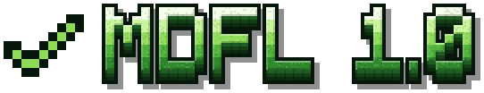
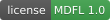

<p align="center"></p>

<p align="center"><b>The Mikhael Dziakanau Friendly License</b><br>
A short, friendly license for Minecraft mods, shader packs and resource packs.</p>

<p align="center"></p>

**Play it, put it in modpacks, stream it, review it, build addons for it.**
Just don't re-upload it or publish changed copies of it.

> **License: [MDFL 1.0](https://github.com/PozziTiv4ik/MDFL/blob/main/MDFL-1.0.md)** · ✅ Modpacks · ✅ Videos & streams · ✅ Compatibility addons · ❌ Reuploads · ❌ Modified copies

📄 **Full text:** [MDFL-1.0.md](MDFL-1.0.md) · plain text for your project: [MDFL-1.0.txt](MDFL-1.0.txt)

## At a glance

| | You can, without asking | |
|---|---|---|
| ✅ | **Play and use it** | single-player, any server, your worlds, builds and maps |
| ✅ | **Put it in modpacks** | on any platform or launcher, unchanged, as long as the pack is free to get (ads, donations and platform rewards are fine) |
| ✅ | **Make videos, streams, reviews** | including monetized ones; use the name, screenshots and logo in titles and thumbnails |
| ✅ | **Build addons and compatibility** | depend on it, call its API, study its code to integrate; your addon is yours |
| ✅ | **Tweak it for yourself** | change it for your own use or your own server, share configs and presets |
| ✅ | **Share it with friends** | an unchanged copy, privately and for free |

| | Please don't, unless you get permission | |
|---|---|---|
| ❌ | **Re-upload it** | to other sites or mirrors; share a link to the official page instead |
| ❌ | **Publish modified copies** | forks, ports, recompiled, repackaged or reskinned builds |
| ❌ | **Copy code or assets** | into other projects, beyond what an addon needs for compatibility |
| ❌ | **Sell it** | or put it behind a paywall, alone or in a modpack |
| ❌ | **Pass it off as yours** | or remove its credits and license |

## Questions

**Can I add this mod to my modpack?**
Yes, on any platform or launcher, as long as players can get the pack for free and the file is unchanged. Modrinth and CurseForge packs already download it from the official page, which is the best way.

**Can I make a YouTube video or stream with it, and earn money from it?**
Yes, and please do. You can use the name, screenshots and logo in your title and thumbnail. A link to the official page is appreciated, not required.

**Can I make an addon or a compatibility patch?**
Yes. Use it as a dependency, call its API and refer to its IDs. Don't bundle the original files; players install them from the official page.

**Can I port it to another loader or Minecraft version?**
Not without permission, but ask the author. A friendly message is all it takes to start the conversation.

**Can I re-upload it to my website or a mirror?**
No. Link to the official page instead. That's how the author keeps updates and download counts in one place.

**Can I use its textures or code in my own mod?**
Not without permission. You may study the code to learn and to build compatibility.

**I run a server. Can I change the mod for it?**
Yes, for your own use, as long as you don't hand out the modified files.

**What happens if someone breaks the rules by accident?**
Their permissions end, and come back automatically if they fix it within 30 days.

## Use MDFL for your project

1. Copy [MDFL-1.0.txt](MDFL-1.0.txt) into your project as `LICENSE` and replace the copyright line,
   for example `Copyright (c) 2026 Your Name`.
2. In your mod metadata, set the license to `MDFL-1.0` (for example `license="MDFL-1.0"` in
   `neoforge.mods.toml`, or `"license": "LicenseRef-MDFL-1.0"` in `fabric.mod.json`).
3. **Modrinth:** choose a custom license with the identifier `LicenseRef-MDFL-1.0` and the URL
   `https://github.com/PozziTiv4ik/MDFL/blob/main/MDFL-1.0.md`.
4. **CurseForge:** choose **Custom License** and paste the text of `MDFL-1.0.txt` with your copyright line.
5. On your page, show the one-liner:

```markdown
**License: [MDFL 1.0](https://github.com/PozziTiv4ik/MDFL/blob/main/MDFL-1.0.md)** · ✅ Modpacks · ✅ Videos & streams · ✅ Compatibility addons · ❌ Reuploads · ❌ Modified copies
```

Badge for your README:

```markdown
[](https://github.com/PozziTiv4ik/MDFL/blob/main/MDFL-1.0.md)
```

Anyone may use the MDFL for their own projects. The text stays unchanged except for the copyright line,
so "MDFL 1.0" always means the same thing. Earlier releases of a project keep the license they were
published with.

## Notes

This is a plain-language license written for Minecraft content, not legal advice. Parts of a project
owned by others (libraries, Minecraft itself) keep their own terms. Projects using the MDFL are not
official Minecraft products and are not approved by or associated with Mojang or Microsoft.

[Русский пересказ](SUMMARY.ru.md) (unofficial; the English text applies).
